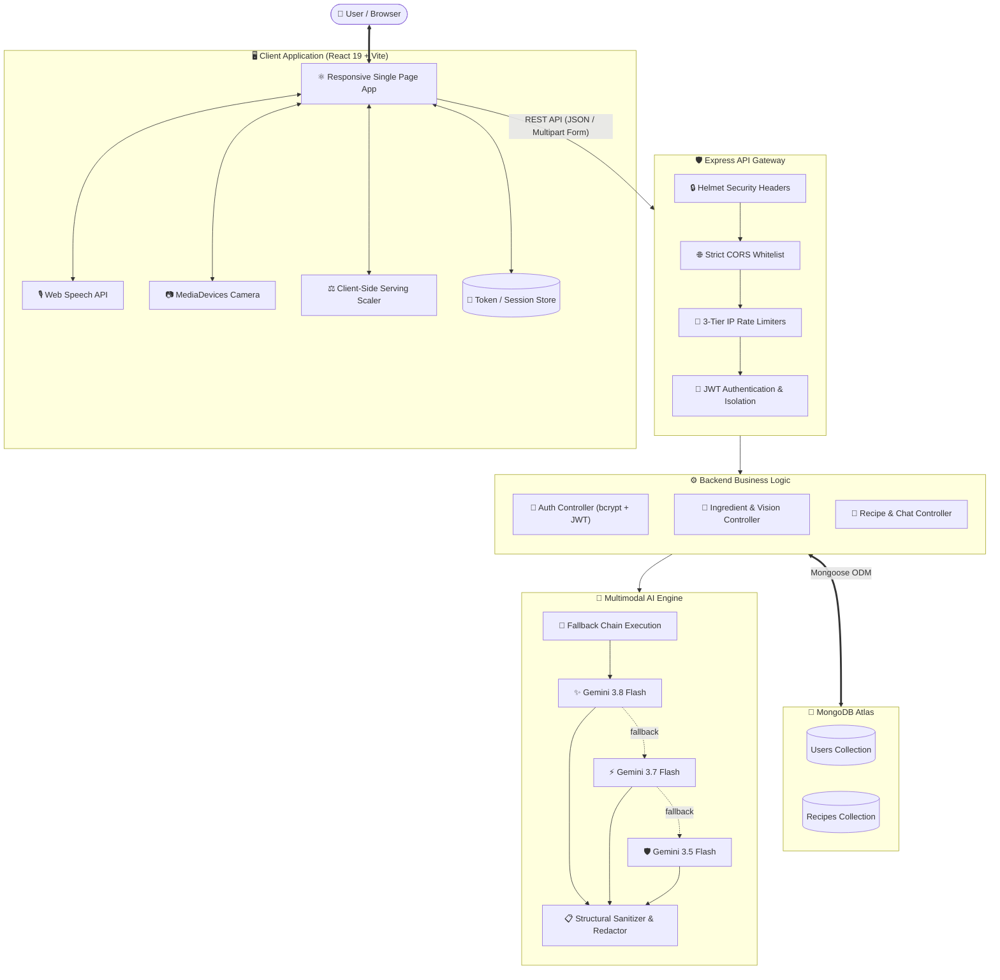

<div align="center">


# 🍳 ChefMind AI
### The Art of Culinary Intelligence · Transform Kitchen Scraps into Gourmet Creations

[](https://github.com/harsh-raj00/ChefMind-AI/actions/workflows/ci.yml)
[](https://nodejs.org)
[](https://react.dev)
[](https://vitejs.dev)
[](https://expressjs.com)
[](https://www.mongodb.com/atlas)
[](https://ai.google.dev)
[](LICENSE)

<p align="center">
  <a href="#-key-features"><b>Key Features</b></a> •
  <a href="#-system-architecture"><b>Architecture</b></a> •
  <a href="#-quick-start"><b>Quick Start</b></a> •
  <a href="#-api-reference"><b>API Reference</b></a> •
  <a href="#-security--hardening"><b>Security</b></a> •
  <a href="#-deployment"><b>Deployment</b></a> •
  <a href="docs/README.md"><b>Full Docs</b></a>
</p>

</div>

---

## 🌟 Overview

**ChefMind AI** is an intelligent, full-stack culinary assistant designed to solve daily mealtime decision paralysis and eliminate domestic food waste. By bridging multimodal computer vision, speech recognition, and generative AI with resilient culinary math, ChefMind turns raw pantry odds and ends into chef-grade, precisely measured recipes.

Whether you **type** your ingredients, **speak** them aloud, or **snap a picture of your refrigerator shelf**, ChefMind inspects your pantry, accommodates dietary restrictions, respects custom cooking styles, and writes fully customized recipes in **English or Hindi (हिन्दी)**.

---

## ✨ Key Features

### 🌐 Native Bilingual Recipe Engine (English & हिन्दी)
* **Devanagari Localized Output**: Seamlessly switches between English and authentic Hindi (`हिन्दी`). The AI crafts recipe titles, descriptions, units (e.g. *चम्मच*, *कटोरी*, *ग्राम*), preparation steps, chef tips, and substitutions in Devanagari script.
* **Resilient Schema Integrity**: Deep-tier JSON validation ensures backend schema keys remain unified while delivering native linguistic experiences.
* **Persistent Language State**: Recipes remember their source language when saved to your personal cookbook.

### 🧑‍🍳 Pre-Generation Culinary Directives
* **Custom Cooking Directives**: Guide the AI before generation begins—request specific appliances (e.g. *air fryer*, *cast-iron skillet*, *one-pot pressure cooker*), speed constraints (*under 20 minutes*), or culinary methods (*charred roast*, *steamed dumpling style*).
* **Granular Heat Profiles**: Five distinct heat preferences from *Mild* and *Medium* to *Authentic Indian / Extra Hot*.

### 📸 Multimodal Vision Pantry Detection
* **Camera & Multi-Image Ingestion**: Capture live photos directly via your phone/laptop camera or upload up to 5 pantry photos simultaneously.
* **Gemini Vision Analysis**: Leverages Gemini Vision with custom confidence thresholds to detect ingredients, flag uncertain items, and provide visual cooking tips.
* **Human-in-the-Loop Confirmation**: Detected ingredients flow into an interactive review tray where you can rename, adjust quantities, add forgotten spices, or delete mistaken items before generating.

### 🎙️ Hands-Free Voice Input
* **Browser Speech Recognition**: Voice-to-text dictation with multi-language accent support (`en-IN`, `en-US`, `hi-IN`). Add multiple ingredients quickly without touching the screen with floury fingers.

### ⚖️ Client-Side Serving Scaler with Culinary Math
* **Zero Latency Scaling**: Scale servings instantly from 1 to 12 persons without invoking paid AI calls.
* **Spice & Seasoning Dampening**: Prevents over-seasoning by dampening non-linear spices (salt, chilies, garam masala, saffron, cumin) during portion increases.
* **Fractional Precision**: Displays natural culinary fractions like `1 1/2 cups` or `3/4 tsp` rather than clumsy decimals like `1.7500`.

### 💬 In-Context AI Sous-Chef Chat
* **Live Recipe Iteration**: Chat with an AI assistant that maintains complete awareness of the active recipe's exact ingredients, quantities, and steps.
* **Recipe Evolution**: Request instant modifications (e.g., *"Make this dairy-free"*, *"I don't have butter, what can I substitute?"*). The assistant returns both an explanation and an updated, validated recipe object.

### 📚 Responsive Personal Cookbook
* **Cloud Persistence**: Save recipes to your MongoDB account with one click.
* **Fast Filtering & Favorites**: Filter by favorite dishes, search by title or ingredients, and scale servings directly from saved cards.
* **Engineered for Mobile (375px–430px)**: Single-column responsive layout, touch-friendly 44px hit-targets, inline SVG icons with tactile click feedback, and zero text overflow.

---

## 🏗 System Architecture

ChefMind AI is built with clean separation of concerns, defensive validation layers, and resilient model fallbacks.

### High-Level Topology



### The 3-Tier Gemini Fallback Chain
Every generative request executes through a resilient fallback circuit. If a tier encounters rate limits (`429`), upstream downtime (`503`), or exceeds a **30-second timeout**, execution immediately cascades to the next stable model:

```
┌────────────────────────┐      fallback      ┌────────────────────────┐      fallback      ┌────────────────────────┐
│  gemini-3.8-flash      │ ─────────────────► │  gemini-3.7-flash      │ ─────────────────► │  gemini-3.5-flash      │
│  (Ultra-low latency)   │                    │  (High-reasoning)      │                    │  (Maximum resilience)  │
└────────────────────────┘                    └────────────────────────┘                    └────────────────────────┘
```

---

## 🧰 Tech Stack

| Layer | Technology | Key Modules & Libraries |
|---|---|---|
| **Frontend** | **React 19** · **Vite 8** | Modern Vanilla CSS, Web Speech API, MediaDevices Camera API, Lucide-style SVG icons |
| **Backend** | **Node.js 20/22** · **Express 5** | Native ES Modules, Multer (multipart), Express Rate Limit, Native `fetch` |
| **Database** | **MongoDB Atlas** | Mongoose 9 ODM with schema validation, indexes, and strict user-scoping |
| **Artificial Intelligence** | **Google Gemini REST API** | Multimodal Vision & Text Models (`gemini-3.8-flash`, `gemini-3.7-flash`, `gemini-3.5-flash`) |
| **Security & Auth** | **JWT** · **bcryptjs** | Custom security headers, CORS protection, multi-tier rate limiters, magic byte inspection |
| **Testing & CI/CD** | **node:test** · **GitHub Actions** | Automated CI pipeline on Node 20 & 22 (unit tests, ESLint, production build) |

---

## 🚀 Quick Start

### Prerequisites
* **Node.js**: `v20.0.0` or higher (verified on Node 20 & 22)
* **npm**: `v9.0.0` or higher
* **MongoDB**: A free [MongoDB Atlas](https://www.mongodb.com/atlas) connection URI (or local `mongod`)
* **Gemini API Key**: From [Google AI Studio](https://aistudio.google.com/app/apikey)

### 1. Clone the Repository
```bash
git clone https://github.com/harsh-raj00/ChefMind-AI.git
cd ChefMind-AI
```

### 2. Install Dependencies
```bash
# Install backend dependencies
npm install

# Install frontend dependencies
npm --prefix frontend install
```

### 3. Setup Environment Variables
Create your local `.env` from the provided template:
```bash
cp .env.example .env
```

Open `.env` in your editor and configure your secrets:
```ini
# Application Port & Mode
PORT=3000
NODE_ENV=development
CLIENT_URL=http://localhost:5173

# Database & Security
MONGODB_URI=mongodb+srv://<username>:<password>@cluster0.example.mongodb.net/chefmind?retryWrites=true&w=majority
JWT_SECRET=your_super_secret_at_least_32_characters_random_key

# Google Gemini API
GEMINI_API_KEY=AIzaSyYourActualGeminiApiKeyHere
```

> [!NOTE]
> During local development, the Vite dev server automatically proxies `/api` requests to `http://localhost:3000`, so no frontend `.env` is necessary.

### 4. Run Development Servers
Start both backend and frontend concurrently in two terminal tabs:

```bash
# Terminal 1: Backend API (runs on http://localhost:3000 with auto-reload)
npm run dev:backend

# Terminal 2: React Frontend (runs on http://localhost:5173)
npm run dev:frontend
```

Open your browser at **`http://localhost:5173`** to begin cooking!

---

## 📜 Available NPM Scripts

Run all root project commands with ease:

| Command | Action |
|---|---|
| `npm run dev:backend` | Starts the Express API server with native Node watch mode (`node --watch`) |
| `npm run dev:frontend` | Starts Vite client server with Instant Hot Module Replacement (HMR) |
| `npm test` | Runs the full 69-suite backend unit and integration test suite (`node:test`) |
| `npm run lint:frontend` | Runs ESLint across all React JSX and utility files |
| `npm run build:frontend` | Compiles the frontend into an optimized, minified production bundle in `frontend/dist` |
| `npm start` | Launches the production Express API server |

---

## 🔌 API Reference

All responses conform to the consistent format `{ success: true, ...data }` or `{ success: false, message: "..." }`.

| Method | Endpoint | Auth | Description |
|:---:|---|:---:|---|
| `POST` | `/api/auth/register` | Public | Register new user account with email & password |
| `POST` | `/api/auth/login` | Public | Authenticate user credentials and return signed JWT |
| `GET` | `/api/auth/me` | 🔒 Bearer | Fetch profile and authentication state of current session |
| `POST` | `/api/ingredients/text` | Public | Parse and clean a raw, comma-separated text ingredient string |
| `POST` | `/api/ingredients/image-analyze` | 🔒 Bearer | Analyze up to 5 uploaded pantry photos via Gemini Vision |
| `POST` | `/api/recipes/generate` | 🔒 Bearer | Generate a structured recipe (supports English & Hindi, custom instructions) |
| `POST` | `/api/recipes/chat` | 🔒 Bearer | Conversational AI chat over an active, unsaved recipe |
| `POST` | `/api/recipes/:id/chat` | 🔒 Bearer | Conversational AI chat scoped to a persisted recipe |
| `POST` | `/api/recipes/save` | 🔒 Bearer | Save an AI-generated or user-customized recipe to user's cookbook |
| `GET` | `/api/recipes` | 🔒 Bearer | Retrieve all recipes owned by the authenticated user |
| `PATCH` | `/api/recipes/:id/favorite` | 🔒 Bearer | Toggle favorite bookmark on a recipe card |
| `DELETE` | `/api/recipes/:id` | 🔒 Bearer | Permanently delete a recipe from the user's cookbook |
| `GET` | `/health` | Public | Liveness probe returning process uptime and timestamp |
| `GET` | `/health/ready` | Public | Readiness probe checking active MongoDB database connectivity |

*Complete request/response JSON payloads and error code specifications are documented in [`docs/api.md`](docs/api.md).*

---

## 🛡️ Security & Hardening

* **Multi-Tier IP Rate Limiting**:
  - `authLimiter`: 15 requests per 15 minutes (mitigates brute-force attacks)
  - `aiLimiter`: 25 requests per 15 minutes (protects AI token quotas from abuse)
  - `apiLimiter`: 300 general requests per 15 minutes
* **Strict Payload Validation**: 1MB payload ceiling on JSON bodies. Uploaded photos are strictly bounded to 5MB per file, 15MB total request size, max 5 images, and validated using MIME magic bytes (`image/jpeg`, `image/png`, `image/webp`).
* **Header Fortification**: Emits `X-Content-Type-Options: nosniff`, `X-Frame-Options: DENY`, `Strict-Transport-Security` (in production), and restrictive Cross-Origin Resource Policies.
* **Sensitive Data Redaction**: Automatic sanitization on all outbound error responses prevents raw Gemini API keys, internal absolute paths, or database stack traces from leaking to clients.
* **Strict Ownership Scoping**: Every database query verifies `userId: req.user.userId`. Users cannot inspect, modify, chat with, or delete recipes belonging to other accounts.

---

## 🧪 Testing & Continuous Integration

ChefMind AI uses Node's built-in, zero-dependency `node:test` framework for deterministic, blisteringly fast tests:

```bash
npm test
```

```text
✔ validateAndSanitizeRecipeData: Validates full structured recipe output and sanitizes missing fields
✔ Serving Scaler Utility: Correctly formats quantities and handles fractional values
✔ Serving Scaler Utility: Dampens salt and spice scaling when scaling up to protect dishes
✔ Recipes API: Generates recipe in Hindi and passes language to Gemini prompt and database
✔ Ingredients Image API: Rejects individual file exceeding 5MB limit with 400 Bad Request
✔ Error Sanitization Security: Sensitive API keys and internal file paths are redacted in error responses
...
ℹ tests 69
ℹ pass 69
ℹ fail 0
```

Every commit and pull request to `main` triggers our automated [GitHub Actions CI Workflow](.github/workflows/ci.yml) which validates the backend tests, frontend ESLint quality, and client production build across **Node.js 20 and Node.js 22**.

---

## ☁️ Deployment Guide

ChefMind AI is engineered to deploy cleanly as a modern decoupled full-stack application:

| Component | Recommended Hosts | Build & Runtime Configuration |
|---|---|---|
| **Backend API** | [Render](https://render.com) · [Railway](https://railway.app) · [Fly.io](https://fly.io) | Start Command: `npm start`<br/>Environment: `NODE_ENV=production`, `PORT`, `MONGODB_URI`, `JWT_SECRET`, `GEMINI_API_KEY`, `CLIENT_URL` |
| **Frontend SPA** | [Vercel](https://vercel.com) · [Netlify](https://netlify.com) · [Cloudflare Pages](https://pages.cloudflare.com) | Root Directory: `frontend`<br/>Build Command: `npm run build`<br/>Output Directory: `dist`<br/>Environment: `VITE_API_BASE_URL=https://your-backend.onrender.com` |

*Step-by-step production setup, custom domain routing, and MongoDB Atlas IP whitelisting are detailed in [`docs/deployment.md`](docs/deployment.md).*

---

## 📁 Repository Structure

```
ChefMind-AI/
├── .github/
│   └── workflows/
│       └── ci.yml               # GitHub Actions CI matrix (Node 20 & 22)
├── backend/
│   ├── controllers/             # auth · ingredient · recipe business logic
│   ├── middleware/              # JWT auth · rate limiters · file upload validators
│   ├── models/                  # Mongoose models (User, Recipe)
│   ├── routes/                  # Express route routers
│   ├── services/                # Gemini client, prompt templates, model fallback chain
│   ├── tests/                   # 69 automated node:test suites
│   ├── app.js                   # Express application setup
│   └── server.js                # Server bootstrap & database connection
├── frontend/
│   ├── public/                  # Favicon & SPA _redirects rule
│   ├── src/
│   │   ├── components/          # React components (Cookbook, Hero, RecipeResult, etc.)
│   │   ├── services/            # Client API abstraction layer (auth, recipes, ingredients)
│   │   ├── utils/               # recipeScaler math & formatting helpers
│   │   ├── App.jsx              # Main app view & state workflow
│   │   ├── Auth.jsx             # Authentication modal
│   │   └── App.css              # Custom responsive stylesheet & animations
│   ├── index.html               # SPA HTML shell
│   └── vite.config.js           # Vite development server & reverse proxy
├── docs/                        # Architecture, API, and Deployment documentation
│   └── assets/                  # High-resolution banners and diagrams
├── .env.example                 # Sanitized environment template
├── LICENSE                      # MIT Open Source License
└── package.json                 # Workspace scripts & dependencies
```

---

## 🗺 Roadmap

- [ ] **Meal Planner Calendar**: Weekly multi-meal scheduler with auto-compiled grocery lists.
- [ ] **Smart Pantry Inventory**: Real-time pantry tracker with ingredient expiration notifications.
- [ ] **Social Share Links**: Public, read-only recipe links with OpenGraph rich preview cards.
- [ ] **Offline PWA Support**: ServiceWorker caching for instant cookbook access in no-connectivity kitchens.
- [ ] **HttpOnly Cookie Migration**: Transitioning JWT storage from localStorage to secure `SameSite=Strict` cookies.

---

## 👨‍💻 Author

<div align="center">

**Harsh Raj**

[](https://github.com/harsh-raj00)
[](https://github.com/harsh-raj00)

*Crafted with passion, modern engineering standards, and culinary curiosity.*

⭐ **Found ChefMind AI helpful? Please give this repository a star on GitHub!**

</div>

---

## 📄 License

This project is open-source software licensed under the **[MIT License](LICENSE)**.
