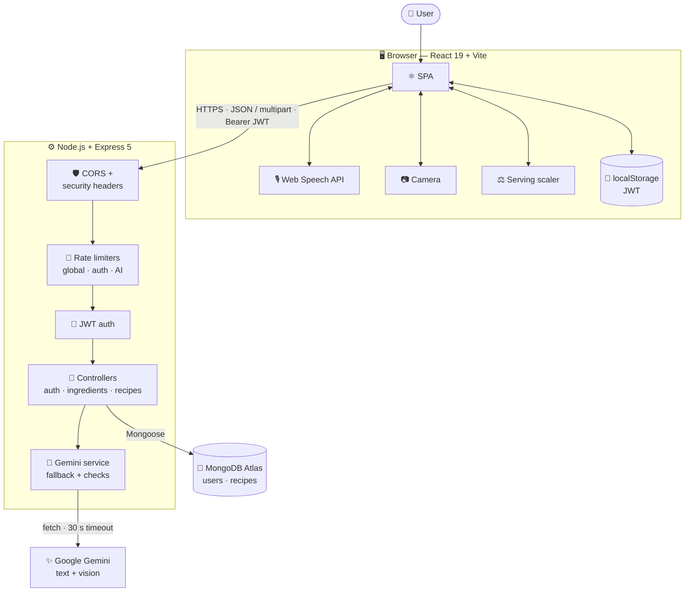
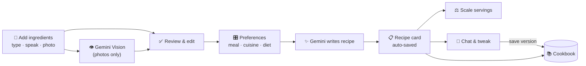

<div align="center">

# 🍳 ChefMind AI

**Turn whatever is in your fridge into a chef-quality recipe — by typing, talking, or snapping a photo.**

[](https://github.com/harsh-raj00/ChefMind-AI/actions/workflows/ci.yml)
[](https://nodejs.org)
[](https://expressjs.com)
[](https://react.dev)
[](https://vitejs.dev)
[](https://www.mongodb.com/atlas)
[](https://ai.google.dev)
[](#-license)

[Features](#-features) · [Quick Start](#-quick-start) · [Architecture](#-architecture) · [API](#-api-at-a-glance) · [Deployment](#-deployment) · [Docs](#-documentation)

</div>

---

## 📖 About

ChefMind AI is a full-stack cooking assistant. Tell it what ingredients you have and how you like to eat. It uses Google Gemini to write a complete recipe with measured ingredients, step-by-step instructions, timings, nutrition, substitutions and tips. You can save the recipe to your cookbook, change the number of servings, or ask follow-up questions about the dish.

The goal is simple: **less "what's for dinner?" and less food waste.**

> [!NOTE]
> Add your screenshots or a demo GIF here, for example `docs/screenshots/home.png`. A visual preview is the fastest way to get people interested in the project.

---

## ✨ Features

| | Feature | What it does |
| 🌐 | **Bilingual recipes (English & Hindi)** | Generate full recipes in English or Hindi (हिन्दी) in native Devanagari script for titles, units, ingredients, and instructions. |
| 🧑‍🍳 | **Personalized cooking instructions** | Specify your exact preparation style, cookware, and custom spice level before the AI writes the recipe. |
| 📸 | **Photo ingredient detection** | Upload up to 5 photos, or use your device camera. Gemini Vision lists the ingredients it sees. |
| 🎙️ | **Voice input** | Say your ingredients aloud with the browser's speech recognition. Several languages are supported, such as `en-IN`. |
| ✅ | **Review before cooking** | Check, edit or remove the detected ingredients before generating a recipe. Nothing is sent to the AI without your review. |
| 🎛️ | **Personalization** | Choose the meal type, cuisine and diet so the recipe fits you. |
| 📋 | **Rich recipes** | Each recipe includes ingredients, instructions, prep and cook times, difficulty, nutrition, dietary notes, substitutions and chef tips. |
| ⚖️ | **Smart serving scaler** | Rescales quantities instantly in your browser, with no extra AI call. Salt and spices scale more gently than other ingredients, and amounts show as friendly fractions such as `1 1/4`. |
| 💬 | **Recipe chat** | Ask follow-up questions like "Can I make this without an oven?" with the recipe as context. |
| 📚 | **Personal cookbook** | Save, favourite and delete recipes, including custom ones you write yourself, with mobile-responsive card details. |
| 🔐 | **Accounts** | JWT sign-in with bcrypt-hashed passwords. Your session is restored automatically when you return. |
| 🛡️ | **Production hardening** | Three-tier rate limiting, security headers, a CORS allow-list, upload checks, health and readiness probes, and Gemini model fallback. |

---

## 🧰 Tech Stack

| Layer | Technology |
|---|---|
| **Frontend** | React 19, Vite 8, plain CSS, Web Speech API, MediaDevices (camera) |
| **Backend** | Node.js (ES modules), Express 5, Multer, express-rate-limit |
| **Database** | MongoDB Atlas via Mongoose 9 |
| **AI** | Google Gemini REST API through native `fetch()` (no SDK) |
| **Auth** | JSON Web Tokens + bcryptjs |
| **Quality** | `node:test` backend suite, ESLint, GitHub Actions on Node 20 and 22 |

---

## 🏗 Architecture

### System overview



### How a recipe is made



### The Gemini fallback chain

Every AI request tries several models in order. If a model is overloaded, rate-limited or slower than **30 s**, the request moves to the next one:

```
gemini-3.8-flash  ──►  gemini-3.7-flash  ──►  gemini-3.5-flash
```

The backend checks every model response before using it. AI output is never trusted unchecked.

📐 **More diagrams** are in [docs/architecture.md](docs/architecture.md): frontend components, the middleware pipeline, sequence diagrams for generation, vision, chat and auth, the ER data model, and the security layers. The full list is in the [docs diagram index](docs/README.md#diagram-index).

---

## 🚀 Quick Start

### Prerequisites

- **Node.js 20+** and npm
- A **MongoDB Atlas** cluster (the free tier is enough) or a local MongoDB
- A **Google Gemini API key** from [Google AI Studio](https://aistudio.google.com/app/apikey)

### 1. Clone and install

```bash
git clone https://github.com/harsh-raj00/ChefMind-AI.git
cd ChefMind-AI

npm install                    # backend dependencies
npm --prefix frontend install  # frontend dependencies
```

### 2. Configure the environment

```bash
cp .env.example .env
```

Then open `.env` and fill in the values:

| Variable | Required | Description |
|---|:---:|---|
| `MONGODB_URI` | ✅ | MongoDB connection string, including the database name |
| `JWT_SECRET` | ✅ | 32+ random characters. Generate one with `openssl rand -hex 32` |
| `GEMINI_API_KEY` | ✅ | Gemini API key. **Backend only, never expose it.** |
| `PORT` | | API port (default `3000`) |
| `NODE_ENV` | | `development` · `test` · `production` |
| `CLIENT_URL` | | Comma-separated CORS allow-list (default dev: `http://localhost:5173`) |
| `TRUST_PROXY` | | Set to `true` behind a reverse proxy. It is on automatically in production. |
| `VITE_API_BASE_URL` | | Frontend only: the backend URL in production. Leave it empty in dev. |

> [!WARNING]
> Anything prefixed with `VITE_` is bundled into public client code. Never put secrets there.

### 3. Run it

Open two terminals:

```bash
# Terminal 1 — API on http://localhost:3000 (auto-reloads)
npm run dev:backend

# Terminal 2 — App on http://localhost:5173
npm run dev:frontend
```

In development, Vite proxies `/api` to `localhost:3000`, so you don't need any CORS setup.

---

## 📜 Scripts

| Command | Description |
|---|---|
| `npm start` | Start the API in production mode |
| `npm run dev:backend` | Start the API with `node --watch` |
| `npm run dev:frontend` | Start the Vite dev server |
| `npm test` | Run the backend test suite (`node --test`) |
| `npm run lint:frontend` | Lint the React code with ESLint |
| `npm run build:frontend` | Build the frontend into `frontend/dist` |

---

## 🔌 API at a Glance

All responses follow the shape `{ success, ...data | message }`. 🔒 marks routes that need an `Authorization: Bearer <token>` header.

| Method | Endpoint | Description |
|---|---|---|
| `POST` | `/api/auth/register` | Create an account |
| `POST` | `/api/auth/login` | Sign in and receive a JWT |
| `GET` | `/api/auth/me` 🔒 | Get the current user |
| `POST` | `/api/ingredients/text` | Parse and validate a text ingredient list |
| `POST` | `/api/ingredients/image-analyze` 🔒 | Detect ingredients in up to 5 images (JPG/PNG/WebP, 5 MB each) |
| `POST` | `/api/recipes/generate` 🔒 | Generate a recipe from ingredients and preferences |
| `POST` | `/api/recipes/chat` 🔒 | Chat about an unsaved recipe |
| `POST` | `/api/recipes/:id/chat` 🔒 | Chat about a saved recipe |
| `POST` | `/api/recipes/save` 🔒 | Save a custom recipe |
| `GET` | `/api/recipes` 🔒 | List your cookbook |
| `PATCH` | `/api/recipes/:id/favorite` 🔒 | Add or remove a favourite |
| `DELETE` | `/api/recipes/:id` 🔒 | Delete a recipe |
| `GET` | `/health` · `/health/ready` | Liveness and readiness probes (not rate-limited) |

Full request and response examples are in [docs/api.md](docs/api.md).

---

## 🔐 Security

- **Rate limiting** (per IP, 15-minute window): 15 requests for auth routes · 25 for AI routes · 300 for general API routes
- **Passwords** are hashed with bcrypt. **JWTs** are checked on every protected route, and every recipe query is scoped to the user who owns it.
- **Headers**: `X-Frame-Options: DENY`, `nosniff`, a strict referrer policy, COOP, and HSTS in production
- **CORS** only allows the origins listed in `CLIENT_URL`
- **Input limits**: 1 MB JSON bodies; uploads must be JPG, PNG or WebP, at most 5 MB each and 5 files total
- **Secrets stay on the server.** The Gemini key never reaches the browser.

> [!IMPORTANT]
> **Known trade-off:** the JWT is stored in `localStorage` for simplicity. That makes it readable by any XSS. Moving to `HttpOnly` cookies is on the roadmap.

---

## 🧪 Testing

```bash
npm test
```

The backend suite uses Node's built-in test runner. It covers **auth, ingredients, image confirmation, recipe generation, chat and security**. Gemini is mocked, so tests never use your API quota.

On every push and pull request to `main`, [CI](.github/workflows/ci.yml) runs tests, lint and a production build on Node **20.x and 22.x**.

---

## 📁 Project Structure

```
ChefMind-AI/
├── backend/
│   ├── server.js            # Entry point: loads env, connects DB, starts server
│   ├── app.js               # Express app: middleware, routes, error handling
│   ├── db.js                # Mongoose connection
│   ├── controllers/         # auth · ingredient · recipe logic
│   ├── middleware/          # JWT auth · rate limiters · Multer uploads
│   ├── models/              # User · Recipe schemas
│   ├── routes/              # /api/auth · /api/ingredients · /api/recipes
│   ├── services/
│   │   └── geminiService.js # Gemini calls, fallback chain, response checks
│   └── tests/               # node:test suites
├── frontend/
│   ├── public/              # favicon, SPA _redirects
│   └── src/
│       ├── components/      # Hero, IngredientSection, CameraCaptureModal,
│       │                    # IngredientConfirmation, RecipeResult, RecipeChat, Cookbook…
│       ├── services/        # API clients (auth, ingredients, recipes)
│       ├── utils/
│       │   └── recipeScaler.js
│       ├── App.jsx  Auth.jsx  main.jsx
├── docs/                    # api.md · architecture.md · deployment.md
├── .github/workflows/ci.yml
└── .env.example
```

---

## ☁️ Deployment

ChefMind AI deploys as **two separate services**:

| Part | Suggested hosts | Notes |
|---|---|---|
| **Backend** | Render · Railway · Fly.io | Start command `npm start`. Set `NODE_ENV=production`, the secrets, and `CLIENT_URL` to your frontend URL. Use `/health/ready` for health checks. |
| **Frontend** | Vercel · Netlify · Cloudflare Pages | Root `frontend`, build `npm run build`, output `dist`. Set `VITE_API_BASE_URL` to your backend URL. `public/_redirects` handles SPA routing. |

In MongoDB Atlas, allow your backend's IP under *Network Access*. Step-by-step instructions are in [docs/deployment.md](docs/deployment.md).

---

## 🗺 Roadmap

- [ ] Move auth tokens to `HttpOnly` cookies with refresh tokens
- [ ] Weekly meal planner and auto-generated shopping list
- [ ] Pantry tracking with expiry reminders to cut food waste further
- [ ] Shareable public recipe links
- [ ] Frontend component tests and end-to-end tests (Playwright)
- [ ] PWA / offline cookbook

---

## 📚 Documentation

| Doc | Contents |
|---|---|
| [docs/api.md](docs/api.md) | Every endpoint, with request and response examples and error codes |
| [docs/architecture.md](docs/architecture.md) | System design, request lifecycle and data models |
| [docs/deployment.md](docs/deployment.md) | Production deployment guide, verification and troubleshooting |
| [docs/README.md](docs/README.md) | Docs index and diagram catalogue |

---

## 🤝 Contributing

1. Fork the repo and create a branch: `git checkout -b feature/amazing-idea`
2. Make your changes, then check that `npm test`, `npm run lint:frontend` and `npm run build:frontend` all pass
3. Commit with a clear message and open a pull request against `main`

Bug reports and feature ideas are welcome in [Issues](https://github.com/harsh-raj00/ChefMind-AI/issues).

---

## 📄 License

Released under the **MIT License**. See [`LICENSE`](LICENSE).

<div align="center">

Built with ❤️ and 🧄 by **Harsh Raj**

⭐ If ChefMind AI saved your dinner, consider [giving the repo a star](https://github.com/harsh-raj00/ChefMind-AI)!

</div>
