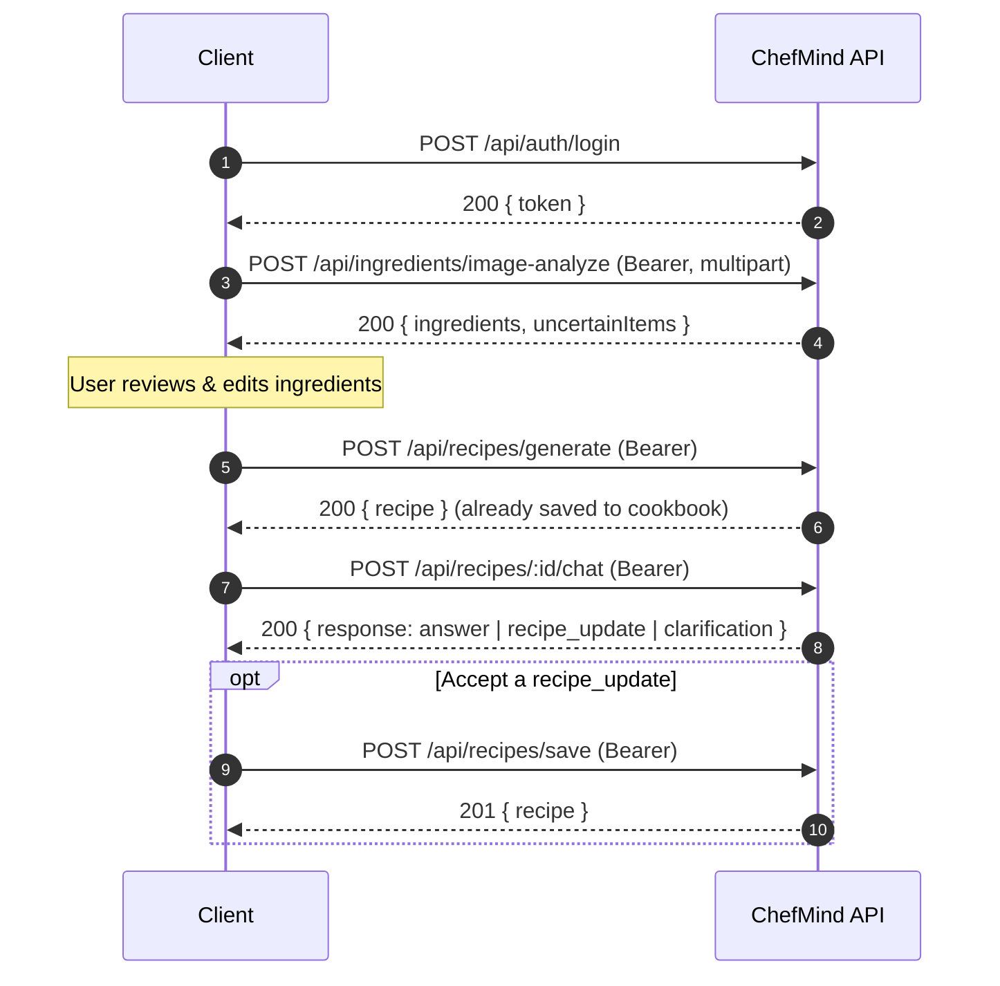

# 🔌 ChefMind AI — API Reference

> Reference for every REST endpoint the ChefMind AI backend exposes.
> 📚 Related docs: [Architecture](architecture.md) · [Deployment](deployment.md) · [Back to README](../README.md)

---

## Endpoint Overview

| Method | Endpoint | Auth | Rate tier | Section |
|---|---|:---:|---|---|
| `POST` | `/api/auth/register` | — | Auth | [3.1](#31-register-user) |
| `POST` | `/api/auth/login` | — | Auth | [3.2](#32-login-user) |
| `GET` | `/api/auth/me` | 🔒 | Global | [3.3](#33-get-authenticated-profile) |
| `POST` | `/api/recipes/generate` | 🔒 | AI | [4.1](#41-generate-ai-recipe) |
| `GET` | `/api/recipes` | 🔒 | Global | [4.2](#42-list-saved-recipes) |
| `PATCH` | `/api/recipes/:id/favorite` | 🔒 | Global | [4.3](#43-toggle-favorite-status) |
| `DELETE` | `/api/recipes/:id` | 🔒 | Global | [4.4](#44-delete-saved-recipe) |
| `POST` | `/api/recipes/chat` · `/api/recipes/:id/chat` | 🔒 | AI | [4.5](#45-conversational-cooking-assistant-chat) |
| `POST` | `/api/recipes/save` | 🔒 | Global | [4.6](#46-save-customized-recipe) |
| `POST` | `/api/ingredients/text` | — | Global | [5.1](#51-validate-text-ingredients) |
| `POST` | `/api/ingredients/image` | 🔒 | Global | [5.2](#52-upload-single-image) |
| `POST` | `/api/ingredients/image-analyze` | 🔒 | AI | [5.3](#53-analyze-image-ingredients-with-gemini-vision) |
| `GET` | `/health` · `/health/ready` | — | None | [6](#6-health--readiness-endpoints) |

### Typical client flow



---

## 1. Global Conventions

- **Base URL:** `http://localhost:3000/api` (Local development)
- **Data Interchange Format:** `application/json` (except multipart file upload endpoints)
- **Authentication Scheme:** `Bearer <JWT_TOKEN>` transmitted via the HTTP `Authorization` header. Tokens are issued by `/api/auth/login` and **expire after 1 hour**.
- **Standard Success Envelope:** All responses return a `success: true` boolean indicator along with resource payloads
- **Standard Error Envelope:**
  ```json
  {
    "success": false,
    "message": "Human-readable description of the error."
  }
  ```

---

## 2. Rate Limiting Policies

The server enforces IP-based rate limiting via `express-rate-limit`:

| Tier | Endpoints | Window | Max Requests | Headers Returned |
| :--- | :--- | :--- | :--- | :--- |
| **Global API** | `/api/*` | 15 minutes | 300 requests | `RateLimit-Limit`, `RateLimit-Remaining`, `RateLimit-Reset` |
| **Auth** | `/api/auth/register`, `/api/auth/login` | 15 minutes | 15 requests | Standard draft-7 headers |
| **AI Workloads** | `/api/recipes/generate`, `/api/recipes/chat`, `/api/recipes/:id/chat`, `/api/ingredients/image-analyze` | 15 minutes | 25 requests | Standard draft-7 headers |

---

## 3. Authentication Endpoints (`/api/auth`)

### 3.1 Register User
- **Method:** `POST`
- **Path:** `/api/auth/register`
- **Rate Limited:** Yes (`authLimiter`)
- **Authentication:** None (Public)
- **Request Headers:** `Content-Type: application/json`

#### Request Body
```json
{
  "name": "Alex Mercer",
  "email": "alex@example.com",
  "password": "Password123!"
}
```
*Validation Rules:*
- `name`: Non-empty string, trimmed length ≤ 100 characters.
- `email`: Non-empty string, valid email format regex, lowercase-normalized.
- `password`: String, length ≥ 8 and ≤ 128 characters.

#### Response: `201 Created`
```json
{
  "success": true,
  "message": "Account created successfully!",
  "user": {
    "id": "670a4421b58a123456789abc",
    "name": "Alex Mercer",
    "email": "alex@example.com"
  }
}
```

#### Error Responses
- `400 Bad Request`: Validation failure (missing fields, weak password, malformed email).
- `409 Conflict`: User with the specified email already exists.
- `429 Too Many Requests`: Rate limit exceeded.

---

### 3.2 Login User
- **Method:** `POST`
- **Path:** `/api/auth/login`
- **Rate Limited:** Yes (`authLimiter`)
- **Authentication:** None (Public)

#### Request Body
```json
{
  "email": "alex@example.com",
  "password": "Password123!"
}
```

#### Response: `200 OK`
```json
{
  "success": true,
  "message": "Login successful!",
  "token": "eyJhbGciOiJIUzI1NiIsInR5cCI6IkpXVCJ9...",
  "user": {
    "id": "670a4421b58a123456789abc",
    "name": "Alex Mercer",
    "email": "alex@example.com"
  }
}
```

#### Error Responses
- `400 Bad Request`: Email and password required or length bounds violated.
- `401 Unauthorized`: Invalid email or password.
- `429 Too Many Requests`: Rate limit exceeded.

---

### 3.3 Get Authenticated Profile
- **Method:** `GET`
- **Path:** `/api/auth/me`
- **Authentication:** Required (`Bearer <token>`)

#### Response: `200 OK`
```json
{
  "success": true,
  "userId": "670a4421b58a123456789abc",
  "user": {
    "id": "670a4421b58a123456789abc",
    "name": "Alex Mercer",
    "email": "alex@example.com"
  }
}
```

#### Error Responses
- `401 Unauthorized`: Missing, invalid, or expired JWT.
- `404 Not Found`: User account no longer exists in database.

---

## 4. Recipe Management Endpoints (`/api/recipes`)

*All recipe endpoints require a valid JWT Bearer token.*

### 4.1 Generate AI Recipe
- **Method:** `POST`
- **Path:** `/api/recipes/generate`
- **Rate Limited:** Yes (`aiLimiter`)
- **Authentication:** Required

#### Request Body
```json
{
  "ingredients": ["eggs", "tomatoes", "baby spinach", "cheddar cheese"],
  "meal": "Breakfast",
  "cuisine": "Mediterranean",
  "diet": "Vegetarian",
  "cookingTime": "20",
  "servings": "2"
}
```
*Validation Rules:*
- `ingredients`: String (comma- or newline-separated) or Array of strings representing confirmed ingredients.
  - Must contain at least 1 valid ingredient.
  - Maximum 50 ingredients.
  - Each individual ingredient length ≤ 150 characters.
  - Combined ingredients length ≤ 2000 characters.
- `meal`, `cuisine`, `diet`: Optional strings (max 50 chars each).
- `cookingTime`: String/number between 5 and 360 minutes (defaults to 30).
- `servings`: String/number between 1 and 20 (defaults to 2).


#### Response: `200 OK`
```json
{
  "success": true,
  "message": "Recipe generated and saved successfully!",
  "recipe": {
    "_id": "670a5991b58a123456789def",
    "title": "Mediterranean Spinach & Cheddar Scramble",
    "description": "Fluffy eggs scrambled with fresh baby spinach, juicy tomatoes, and melted sharp cheddar.",
    "servings": 2,
    "prepTime": "5 mins",
    "cookTime": "15 mins",
    "prepTimeMinutes": 5,
    "cookTimeMinutes": 15,
    "difficulty": "Easy",
    "ingredients": [
      {
        "name": "large eggs",
        "quantity": 4,
        "unit": "piece",
        "optional": false
      },
      {
        "name": "fresh baby spinach",
        "quantity": 1,
        "unit": "cup",
        "optional": false
      },
      {
        "name": "medium tomato, diced",
        "quantity": 1,
        "unit": "piece",
        "optional": false
      },
      {
        "name": "shredded cheddar cheese",
        "quantity": 0.5,
        "unit": "cup",
        "optional": false
      },
      {
        "name": "olive oil",
        "quantity": 1,
        "unit": "tbsp",
        "optional": false
      },
      {
        "name": "fresh chives",
        "quantity": 1,
        "unit": "tbsp",
        "optional": true
      }
    ],
    "instructions": [
      {
        "step": 1,
        "title": "Sauté the Vegetables",
        "description": "Heat olive oil in a non-stick skillet over medium heat. Add diced tomatoes and spinach; sauté until spinach is wilted (approx. 2 mins)."
      },
      {
        "step": 2,
        "title": "Cook the Scramble",
        "description": "Whisk eggs with a pinch of salt and pepper; pour into skillet. Gently stir until soft curds form, fold in cheddar cheese, and remove from heat."
      }
    ],
    "substitutions": [
      {
        "original": "cheddar cheese",
        "replacement": "feta cheese",
        "ratio": "1:1",
        "notes": "Adds a tangy, authentic Mediterranean saltiness."
      }
    ],
    "dietaryNotes": [
      "Vegetarian",
      "Keto-Friendly"
    ],
    "nutrition": {
      "calories": 340,
      "protein": "18g",
      "carbs": "5g",
      "fat": "26g",
      "fiber": "2g"
    },
    "tips": [
      "Remove eggs from heat slightly before fully set; residual pan heat finishes the cooking."
    ],
    "meal": "Breakfast",
    "cuisine": "Mediterranean",
    "diet": "Vegetarian",
    "isFavorite": false,
    "owner": "670a4421b58a123456789abc",
    "createdAt": "2026-10-12T05:00:00.000Z",
    "updatedAt": "2026-10-12T05:00:00.000Z"
  }
}
```

---

### 4.2 List Saved Recipes
- **Method:** `GET`
- **Path:** `/api/recipes`
- **Authentication:** Required

#### Response: `200 OK`
```json
{
  "success": true,
  "count": 1,
  "recipes": [
    {
      "_id": "670a5991b58a123456789def",
      "title": "Mediterranean Spinach & Cheddar Scramble",
      "description": "...",
      "ingredients": ["..."],
      "instructions": ["..."],
      "prepTime": "5 mins",
      "cookTime": "15 mins",
      "servings": 2,
      "isFavorite": false,
      "owner": "670a4421b58a123456789abc",
      "createdAt": "2026-10-12T05:00:00.000Z"
    }
  ]
}
```

---

### 4.3 Toggle Favorite Status
- **Method:** `PATCH`
- **Path:** `/api/recipes/:id/favorite`
- **Authentication:** Required

#### Response: `200 OK`
```json
{
  "success": true,
  "recipe": {
    "_id": "670a5991b58a123456789def",
    "title": "Mediterranean Spinach & Cheddar Scramble",
    "isFavorite": true
  }
}
```

#### Error Responses
- `400 Bad Request`: Invalid MongoDB ObjectId format.
- `404 Not Found`: Recipe not found or not owned by the authenticated user.

---

### 4.4 Delete Saved Recipe
- **Method:** `DELETE`
- **Path:** `/api/recipes/:id`
- **Authentication:** Required

#### Response: `200 OK`
```json
{
  "success": true,
  "message": "Recipe deleted successfully."
}
```

#### Error Responses
- `400 Bad Request`: Invalid MongoDB ObjectId format.
- `404 Not Found`: Recipe not found or not owned by user.

---

### 4.5 Conversational Cooking Assistant (`/chat`)
- **Method:** `POST`
- **Paths:**
  - `/api/recipes/chat` (in-memory or saved recipe payload)
  - `/api/recipes/:id/chat` (saved recipe ID parameter)
- **Authentication:** Required (`Bearer <token>`)
- **Rate Limited:** Yes (`aiLimiter`)
- **Request Headers:** `Content-Type: application/json`

#### Request Body
```json
{
  "recipeId": "670a5991b58a123456789def",
  "recipe": { ... },
  "message": "Replace paneer with extra-firm tofu.",
  "history": [
    { "role": "user", "content": "How spicy is this?" },
    { "role": "assistant", "content": "It has medium heat with 1 tsp chili powder." }
  ]
}
```
*Validation Rules:*
- `message`: Required non-empty string, length ≤ 500 characters.
- `history`: Optional array of messages, maximum 10 items.
- `recipe` or `recipeId`: Must resolve to a valid recipe. When querying a saved recipe ID or an object with `_id`, strict ownership by the authenticated user is enforced.

#### Response: `200 OK` (Informational Answer)
```json
{
  "success": true,
  "response": {
    "type": "answer",
    "message": "Tomatoes provide acidity and body to the sauce. You can substitute 2 tbsp tomato paste diluted in water or canned crushed tomatoes."
  }
}
```

#### Response: `200 OK` (Recipe Modification Proposal)
```json
{
  "success": true,
  "response": {
    "type": "recipe_update",
    "message": "I updated the recipe to use extra-firm tofu instead of paneer.",
    "changes": [
      {
        "field": "ingredients",
        "description": "Replaced 250g paneer with 250g extra-firm tofu."
      }
    ],
    "updatedRecipe": {
      "title": "Tofu Tikka Masala",
      "description": "...",
      "servings": 4,
      "prepTimeMinutes": 15,
      "cookTimeMinutes": 25,
      "difficulty": "Easy",
      "ingredients": [ ... ],
      "instructions": [ ... ],
      "substitutions": [ ... ],
      "dietaryNotes": ["Vegan", "Dairy-Free"],
      "nutrition": { ... },
      "tips": [ ... ]
    }
  }
}
```

#### Response: `200 OK` (Clarification)
```json
{
  "success": true,
  "response": {
    "type": "clarification",
    "message": "Would you like me to adjust the spice level, make it dairy-free, or scale the number of servings?"
  }
}
```

#### Error Responses
- `400 Bad Request`: Missing or empty message, message > 500 chars, history > 10 items, invalid history format, or missing recipe context.
- `401 Unauthorized`: Missing or invalid Bearer token.
- `404 Not Found`: Recipe not found or not owned by user.
- `429 Too Many Requests`: Rate limit exceeded.
- `500 Internal Server Error`: Upstream AI failure.

---

### 4.6 Save Customized Recipe
- **Method:** `POST`
- **Path:** `/api/recipes/save`
- **Authentication:** Required (`Bearer <token>`)
- **Request Headers:** `Content-Type: application/json`

Saves an updated recipe proposal as a brand-new cookbook entry without modifying the user's original recipe.

#### Request Body
```json
{
  "recipe": {
    "title": "Tofu Tikka Masala",
    "description": "...",
    "servings": 4,
    "prepTimeMinutes": 15,
    "cookTimeMinutes": 25,
    "difficulty": "Easy",
    "ingredients": [ ... ],
    "instructions": [ ... ]
  }
}
```

#### Response: `201 Created`
```json
{
  "success": true,
  "message": "Customized recipe saved to your cookbook!",
  "recipe": {
    "_id": "670a6121b58a123456789abc",
    "title": "Tofu Tikka Masala",
    "owner": "670a4421b58a123456789abc",
    "isFavorite": false,
    "createdAt": "2026-10-12T06:00:00.000Z"
  }
}
```

#### Error Responses
- `400 Bad Request`: Missing or invalid recipe object.
- `401 Unauthorized`: Missing or invalid Bearer token.
- `500 Internal Server Error`: Database failure.

---

## 5. Ingredient Analysis Endpoints (`/api/ingredients`)

### 5.1 Validate Text Ingredients
- **Method:** `POST`
- **Path:** `/api/ingredients/text`
- **Authentication:** None (Public)

#### Request Body
```json
{
  "ingredients": "bell peppers, mushrooms, garlic"
}
```

#### Response: `200 OK`
```json
{
  "success": true,
  "inputType": "text",
  "ingredients": "bell peppers, mushrooms, garlic",
  "message": "Ingredients received successfully!"
}
```

---

### 5.2 Upload Single Image
- **Method:** `POST`
- **Path:** `/api/ingredients/image`
- **Authentication:** Required (`Bearer <token>`)
- **Content-Type:** `multipart/form-data`

A utility endpoint that receives and validates one image without calling the AI. Use [5.3](#53-analyze-image-ingredients-with-gemini-vision) to detect the ingredients in it.

#### Form Data Fields
- `image`: A single binary image file (`image/jpeg`, `image/png` or `image/webp`; ≤ 5 MB)

#### Response: `200 OK`
```json
{
  "success": true,
  "inputType": "image",
  "filename": "fridge.jpg",
  "size": 482113,
  "contentType": "image/jpeg",
  "message": "Image received successfully!"
}
```

#### Error Responses
- `400 Bad Request`: No file uploaded, unsupported type, file contents that aren't a real image, or a file larger than 5 MB.
- `401 Unauthorized`: Missing or invalid Bearer token.

---

### 5.3 Analyze Image Ingredients with Gemini Vision
- **Method:** `POST`
- **Path:** `/api/ingredients/image-analyze`
- **Authentication:** Required (`Bearer <token>`)
- **Rate Limited:** Yes (`aiLimiter`)
- **Content-Type:** `multipart/form-data`

#### Form Data Fields
- `images`: Binary image files (1 to 5 files; `image/jpeg`, `image/png`, or `image/webp`; ≤ 5 MB each, ≤ 15 MB combined)

#### Response: `200 OK`
```json
{
  "success": true,
  "ingredients": [
    "ripe tomatoes",
    "red onion",
    "cilantro",
    "fresh lime"
  ],
  "observations": "Fresh vegetables laid out on a kitchen cutting board across multiple photos.",
  "uncertainItems": []
}
```

#### Error Responses
- `400 Bad Request`: No files uploaded, unsupported MIME type, corrupt/spoofed image data, file exceeding 5 MB, more than 5 images uploaded, or combined size exceeding 15 MB.
- `401 Unauthorized`: Missing or invalid Bearer token.
- `429 Too Many Requests`: AI rate limit exceeded.
- `500 Internal Server Error`: Gemini API upstream error after cascade exhaustion.

---

## 6. Health & Readiness Endpoints

These endpoints need no authentication, are **not rate-limited**, and are available both with and without the `/api` prefix.

| Endpoint | Purpose | Status codes |
|---|---|---|
| `GET /health` · `GET /api/health` | Liveness: the process is up | Always `200` |
| `GET /health/ready` · `GET /api/health/ready` | Readiness: MongoDB is connected | `200` ready · `503` not ready |

#### Response: `200 OK` (`/health`)
```json
{
  "success": true,
  "status": "healthy",
  "uptime": 3721,
  "services": { "database": "connected" },
  "timestamp": "2026-10-12T05:00:00.000Z"
}
```

#### Response: `503 Service Unavailable` (`/health/ready`)
```json
{
  "success": false,
  "status": "not_ready",
  "uptime": 12,
  "services": { "database": "disconnected" },
  "timestamp": "2026-10-12T05:00:00.000Z"
}
```

---

## 7. Common Error Codes

| Status | Meaning in ChefMind AI |
|---|---|
| `400` | Validation failed, malformed JSON, invalid ObjectId, or an upload error |
| `401` | Missing, invalid or expired JWT, or wrong login credentials |
| `404` | Resource not found **or not owned by you**. The API does not reveal whether it exists. |
| `409` | Email already registered |
| `429` | Rate limit exceeded. See the `RateLimit-*` headers for when to retry. |
| `500` | Unexpected server error, or every Gemini model in the fallback chain failed |
| `503` | Readiness probe: database disconnected |
