# 🏗 ChefMind AI — Architecture & System Design

> How ChefMind AI is built: its layers, data flows, data model, security design and the reasons behind key decisions.
> 📚 Related docs: [API Reference](api.md) · [Deployment](deployment.md) · [Back to README](../README.md)

---

## Contents

1. [Architectural Overview](#1-architectural-overview)
2. [System Architecture](#2-system-architecture)
3. [Frontend Component Architecture](#3-frontend-component-architecture)
4. [Backend Middleware Pipeline](#4-backend-middleware-pipeline)
5. [End-to-End User Journey](#5-end-to-end-user-journey)
6. [Request Lifecycle: Recipe Generation](#6-request-lifecycle-recipe-generation)
7. [Image Ingredient Detection Flow](#7-image-ingredient-detection-flow)
8. [Recipe Chat Flow](#8-recipe-chat-flow)
9. [Gemini Fallback Chain](#9-gemini-fallback-chain)
10. [Data Model](#10-data-model)
11. [Authentication Flow](#11-authentication-flow)
12. [Security Model](#12-security-model)
13. [Key Design Decisions](#13-key-design-decisions)

---

## 1. Architectural Overview

ChefMind AI is a **decoupled, three-tier web application**:

| Tier | Technology | Responsibilities |
|---|---|---|
| **Presentation** | React 19 SPA (Vite) | UI and form state, voice input (Web Speech API), camera capture, client-side recipe scaling, session in `localStorage` |
| **Application** | Node.js + Express 5 (MVC) | Routing, JWT auth, CORS, security headers, tiered rate limiting, input checks, consistent error responses |
| **Data** | MongoDB Atlas via Mongoose 9 | Users and recipes, with every recipe tied to its owner |
| **AI service** | Google Gemini REST via native `fetch()` | Recipe generation, ingredient detection in photos, recipe chat, with model fallback and response checks |

---

## 2. System Architecture

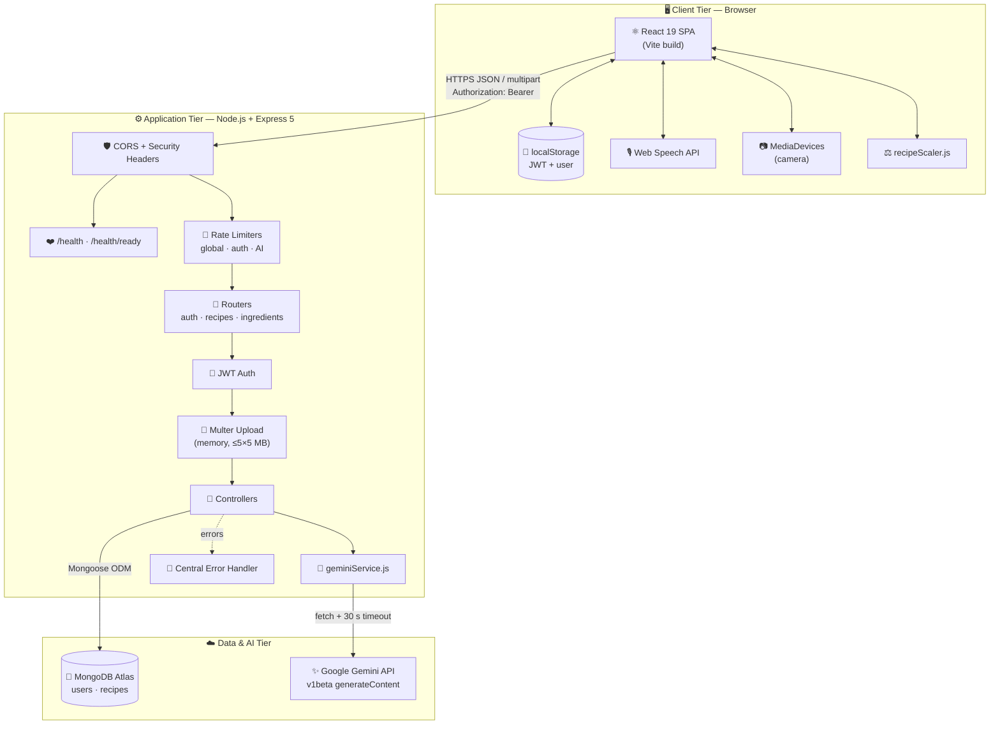

---

## 3. Frontend Component Architecture

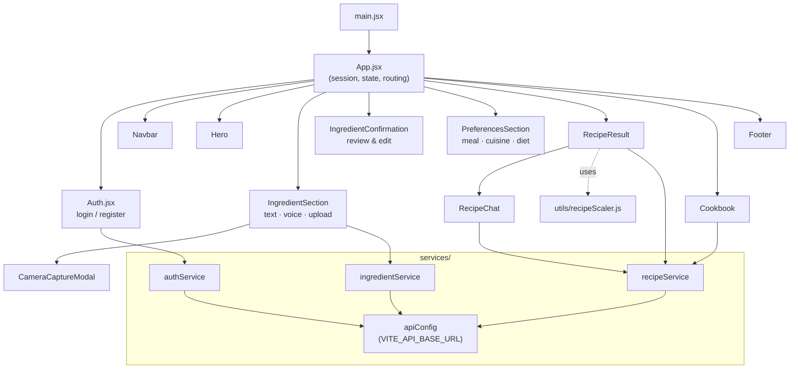

---

## 4. Backend Middleware Pipeline

Every request passes through these stages in order, and each stage can stop it early:

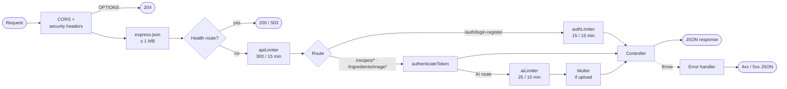

---

## 5. End-to-End User Journey

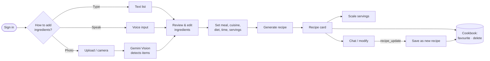

---

## 6. Request Lifecycle: Recipe Generation

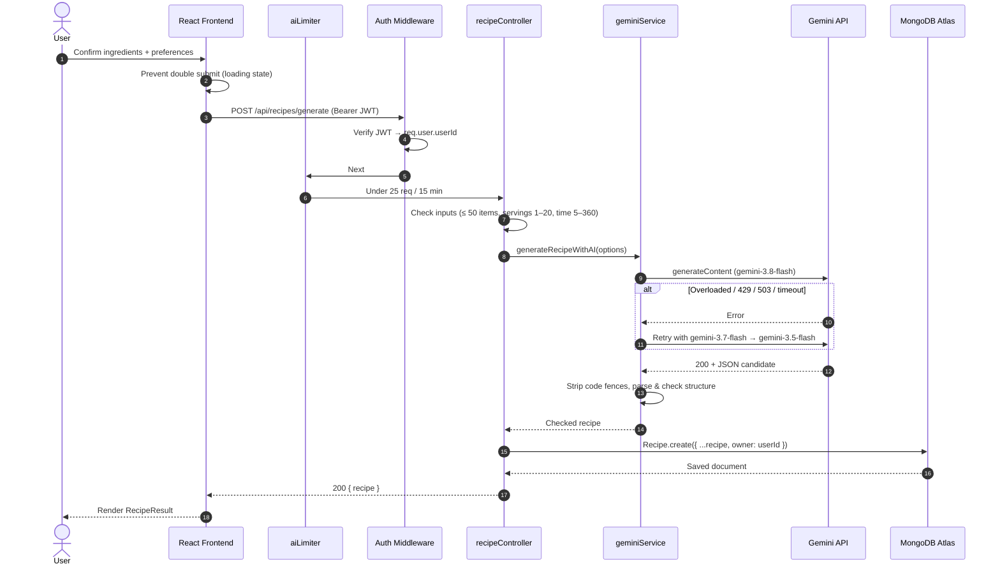

---

## 7. Image Ingredient Detection Flow

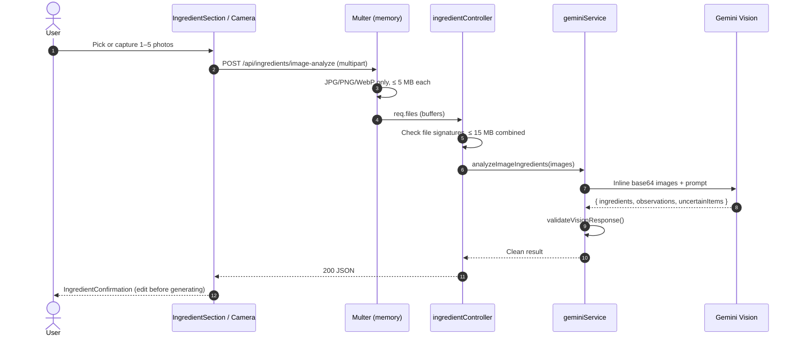

> Images stay **in memory only** and are never written to disk or the database.

---

## 8. Recipe Chat Flow

The chat assistant returns one of three response types, and the UI handles each one differently:

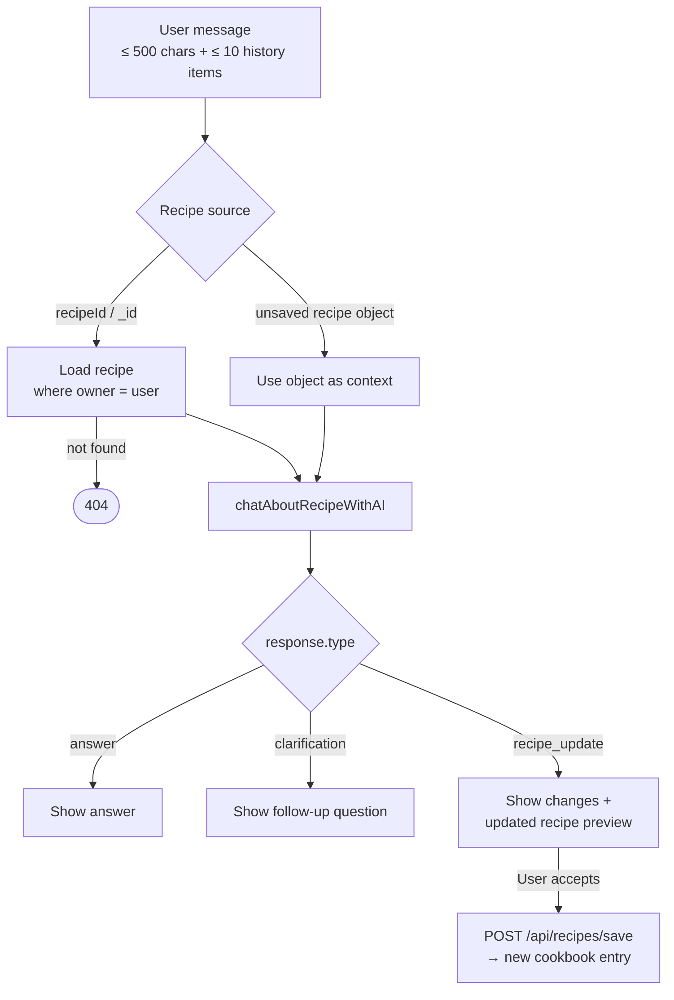

---

## 9. Gemini Fallback Chain

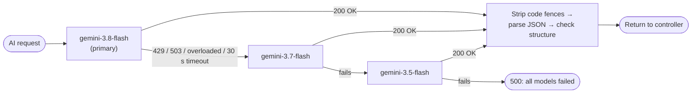

- Every call uses `AbortSignal.timeout(30000)`, so no request can hang.
- The backend checks every model response before using it. Model output is never trusted unchecked.
- The API key goes in a header from the server and never reaches the browser.

---

## 10. Data Model

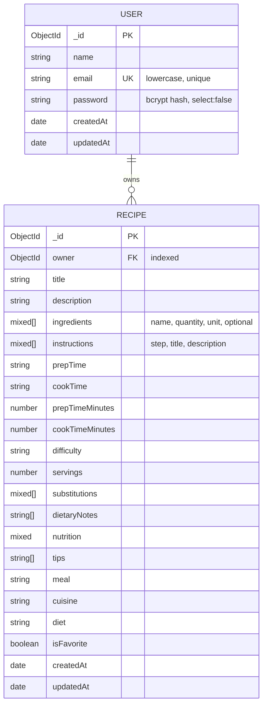

**Indexes:** `users.email` (unique) · `recipes.owner` · `recipes { owner: 1, createdAt: -1 }`. The compound index makes loading the newest recipes in a cookbook fast.

---

## 11. Authentication Flow

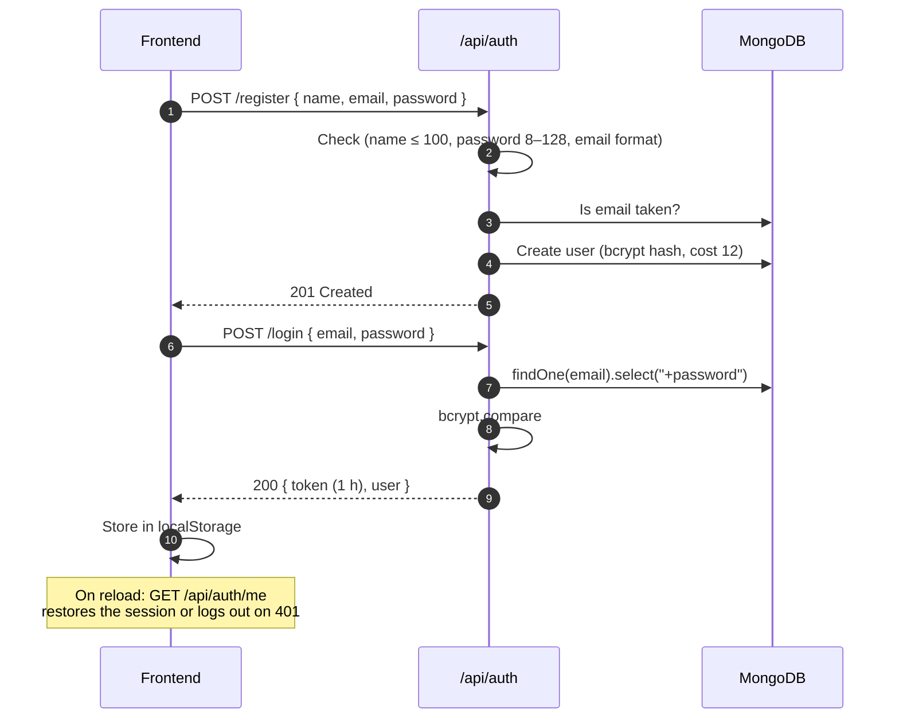

---

## 12. Security Model

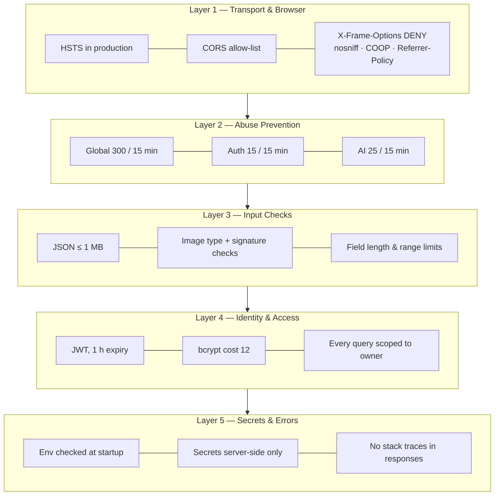

| Threat | Mitigation |
|---|---|
| Brute-force login | `authLimiter` (15 / 15 min / IP) and the same error message for unknown email and wrong password |
| Password-hash CPU DoS | Passwords are capped at 128 characters |
| Reading another user's recipes | Every query includes `owner: req.user.userId`, and someone else's recipe returns **404** |
| AI cost abuse | AI routes need login and are limited to 25 requests per 15 min per IP |
| Spoofed uploads | MIME allow-list plus a check of the file's real signature bytes, with size and count limits |
| Leaked secrets | The Gemini key, JWT secret and DB URI stay in backend env vars only, and `.env` is git-ignored |
| Weak production secret | Startup fails if `JWT_SECRET` is shorter than 32 characters in production |

---

## 13. Key Design Decisions

| Decision | Why | Trade-off |
|---|---|---|
| **Native `fetch()` instead of the Gemini SDK** | No extra dependency, full control over timeouts and fallback | Responses have to be parsed by hand |
| **Generated recipes saved automatically** | A recipe is never lost, and the cookbook always matches what the user saw | Unwanted recipes have to be deleted |
| **Serving scaler runs in the browser** | Instant, free and works offline, with no AI call | Uses heuristics, e.g. salt and spices scale non-linearly |
| **Ingredient review step** | The user checks AI-detected items before generating, so hallucinated ingredients don't reach the recipe | One extra click |
| **Chat edits saved as *new* recipes** | The original recipe is never overwritten | The cookbook can contain several versions of a dish |
| **JWT in `localStorage`** | Simple and works across separately hosted frontend and backend | Readable by any XSS. Moving to `HttpOnly` cookies is on the roadmap. |
| **Separate frontend and backend hosting** | Each part can scale on its own, and the frontend can be served from a CDN | Needs CORS and `VITE_API_BASE_URL` configuration |
