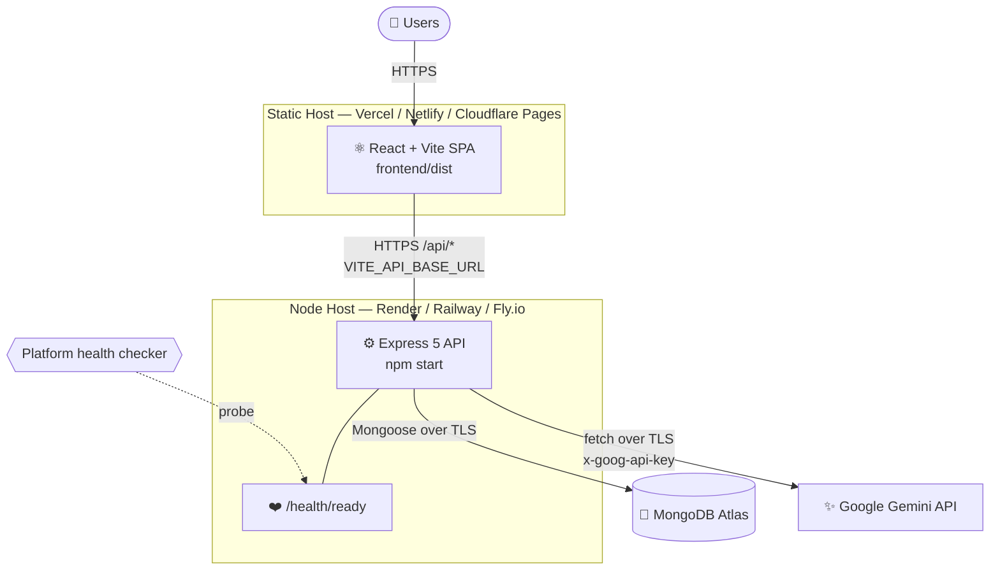
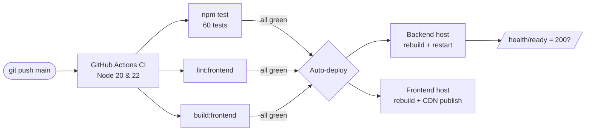
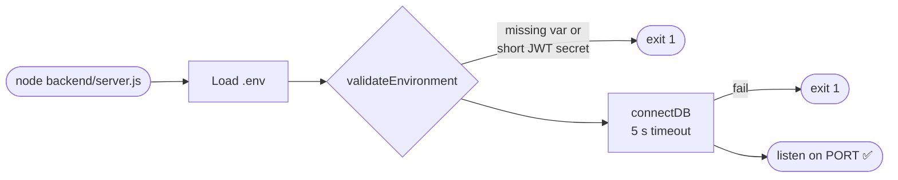

# ☁️ ChefMind AI — Production Deployment Guide

> How to deploy the ChefMind AI backend API and static React frontend to production as two separate services.
> 📚 Related docs: [Architecture](architecture.md) · [API Reference](api.md) · [Back to README](../README.md)

---

## Contents

1. [Deployment Topology](#1-deployment-topology)
2. [Pre-flight Checklist](#2-pre-flight-checklist)
3. [Backend Deployment](#3-backend-deployment)
4. [Frontend Deployment](#4-frontend-deployment)
5. [Database & Secrets Hardening](#5-database--secrets-hardening)
6. [Post-deploy Verification](#6-post-deploy-verification)
7. [Troubleshooting](#7-troubleshooting)

---

## 1. Deployment Topology



### Deployment pipeline



> Connect both hosts to your GitHub repo and turn on **"deploy only when CI passes"** if your host supports it.

---

## 2. Pre-flight Checklist

- [ ] `npm test`, `npm run lint:frontend` and `npm run build:frontend` all pass locally
- [ ] MongoDB Atlas cluster created, database user set up, and network access configured
- [ ] Gemini API key created and **restricted** to the Generative Language API
- [ ] Production `JWT_SECRET` generated (`openssl rand -hex 32`)
- [ ] `.env` is **not** committed (`git check-ignore .env` should print a match)

---

## 3. Backend Deployment

The backend uses Express, Mongoose and native `fetch`. It runs on any Node.js platform, such as Render, Railway, Fly.io, Heroku or AWS App Runner.

### Service configuration

| Setting | Value |
|---|---|
| Runtime | Node.js `>= 20` |
| Root directory | Repository root (`.`) |
| Build command | `npm install --omit=dev` |
| Start command | `npm start` (runs `node backend/server.js`) |
| Port | Uses `process.env.PORT` from the host, or `3000` |
| Health check path | `/health/ready` |

### Environment variables

| Variable | Required | Example |
|:---|:---:|:---|
| `NODE_ENV` | ✅ | `production` |
| `MONGODB_URI` | ✅ | `mongodb+srv://<user>:<pwd>@cluster0.example.mongodb.net/chefmind?retryWrites=true&w=majority` |
| `JWT_SECRET` | ✅ | 64-character hex string (**at least 32 characters, enforced at startup**) |
| `GEMINI_API_KEY` | ✅ | Key from Google AI Studio |
| `CLIENT_URL` | ✅ | `https://chefmind.vercel.app` (comma-separate multiple origins) |
| `TRUST_PROXY` | | `true`. It is on automatically when `NODE_ENV=production`. |
| `PORT` | | Set by the platform |

### Startup sequence



The process exits on any configuration error instead of starting in a broken state, so a bad deploy shows up immediately in your host's logs.

### Health probes

| Probe | Endpoint | Healthy | Unhealthy |
|---|---|---|---|
| Liveness | `GET /health` | `200` | — |
| Readiness | `GET /health/ready` | `200` (DB connected) | `503` (DB disconnected) |

Neither endpoint exposes credentials, connection strings or internal paths, and neither is rate-limited.

---

## 4. Frontend Deployment

The frontend builds to static HTML, CSS and JS. You can host it on Vercel, Netlify, Cloudflare Pages or S3 + CloudFront.

| Setting | Value |
|---|---|
| Framework preset | Vite |
| Root directory | `frontend` |
| Build command | `npm run build` |
| Output directory | `dist` |
| SPA routing | `frontend/public/_redirects` routes all paths to `/index.html` on Netlify and Cloudflare Pages |

| Variable | Example |
|:---|:---|
| `VITE_API_BASE_URL` | `https://chefmind-backend.onrender.com` |

> [!CAUTION]
> `VITE_` variables are **embedded in the public JavaScript bundle**. Never set `GEMINI_API_KEY`, `JWT_SECRET` or `MONGODB_URI` on the frontend host.

> [!NOTE]
> `VITE_API_BASE_URL` is read **at build time**. After you change it, rebuild and redeploy the frontend.

---

## 5. Database & Secrets Hardening

### JWT secret
```bash
openssl rand -hex 32
```
Paste the output into your backend host's dashboard as `JWT_SECRET`. Changing it later signs every user out, because all existing tokens become invalid.

### MongoDB Atlas
1. **Security → Database Access:** create a user that only has `readWrite` on the `chefmind` database.
2. **Security → Network Access:** use your host's static outbound IPs if it has them.
3. If your host uses changing IPs (for example Render's free tier) and you have to allow `0.0.0.0/0`, use a strong generated password and check the Atlas access history regularly.

### Google Gemini
1. Restrict the key to the **Generative Language API** only.
2. Set **budgets and alerts** in Google Cloud Billing, plus daily quota caps, so a usage spike can't become a large bill.

### CORS
```bash
CLIENT_URL=https://chefmind.vercel.app,https://chefmind.yourdomain.com
```
The server compares each request's `Origin` to this list, ignoring trailing slashes. If it matches, the server sends that origin back in `Access-Control-Allow-Origin` with `Vary: Origin`.

---

## 6. Post-deploy Verification

```bash
API=https://chefmind-backend.onrender.com

# 1. Liveness and readiness
curl -s $API/health | jq
curl -s -o /dev/null -w "%{http_code}\n" $API/health/ready   # expect 200

# 2. Security headers present
curl -sI $API/health | grep -Ei "strict-transport|x-frame|x-content-type"

# 3. CORS answers your frontend origin
curl -sI -H "Origin: https://chefmind.vercel.app" $API/health | grep -i access-control-allow-origin

# 4. Protected routes reject anonymous calls
curl -s -o /dev/null -w "%{http_code}\n" $API/api/recipes   # expect 401
```

Then, in the browser: register → log in → generate a recipe → reload the page (you should stay signed in) → open the cookbook.

---

## 7. Troubleshooting

| Symptom | Likely cause | Fix |
|---|---|---|
| Backend exits on boot with `Missing required environment variables` | A secret isn't set | Add it in the host's dashboard |
| `JWT_SECRET must be at least 32 characters` | Short secret in production | Generate one with `openssl rand -hex 32` |
| `/health/ready` returns `503` | Atlas IP not allowed, or wrong URI | Check Network Access and `MONGODB_URI` |
| Browser shows a CORS error | `CLIENT_URL` doesn't match the frontend origin | Set the exact origin, including `https://` |
| Frontend calls `localhost` in production | `VITE_API_BASE_URL` wasn't set at build time | Set it and **rebuild** |
| Every visitor hits `429` together | The proxy IP is being rate-limited instead of each client | Make sure `TRUST_PROXY=true` or `NODE_ENV=production` |
| Recipe generation returns `500` | Every Gemini model failed (quota, bad key) | Check the backend logs for `[Gemini]` warnings and your AI Studio quota |
| Refreshing a page shows a 404 | SPA rewrites missing | Keep `_redirects` (Netlify/Cloudflare) or add a rewrite to `/index.html` (Vercel) |
